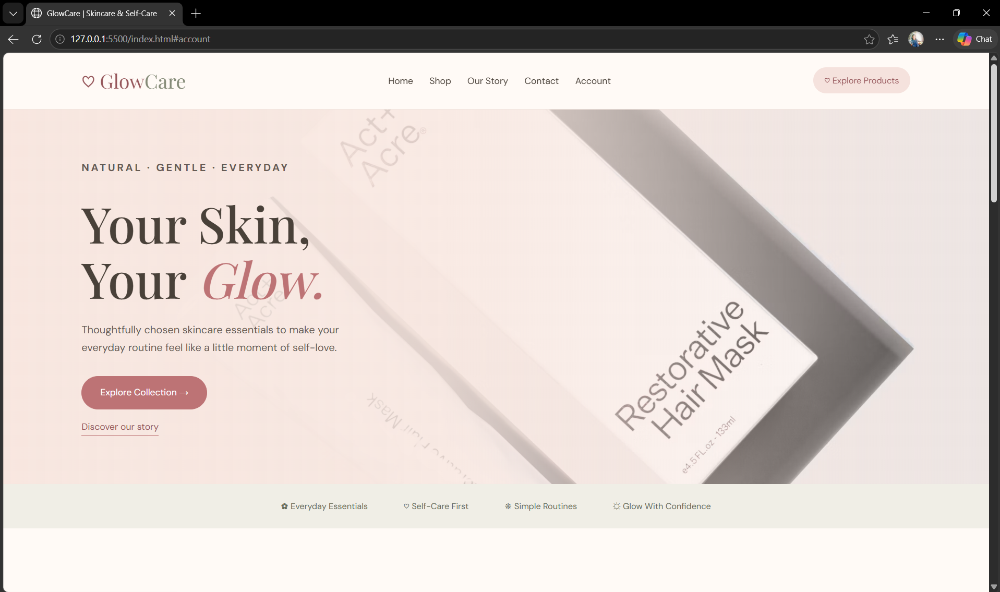
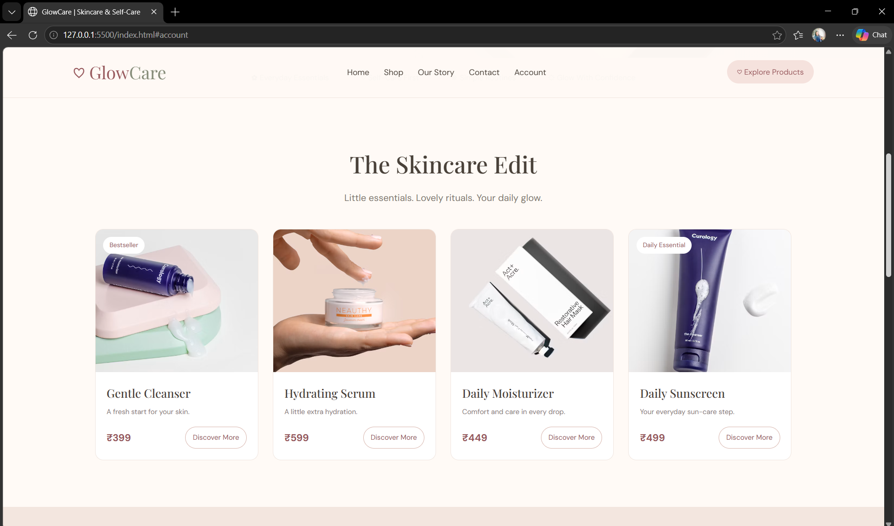
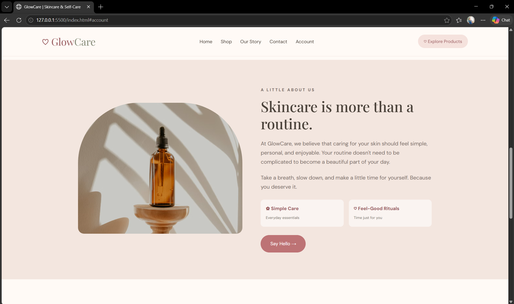
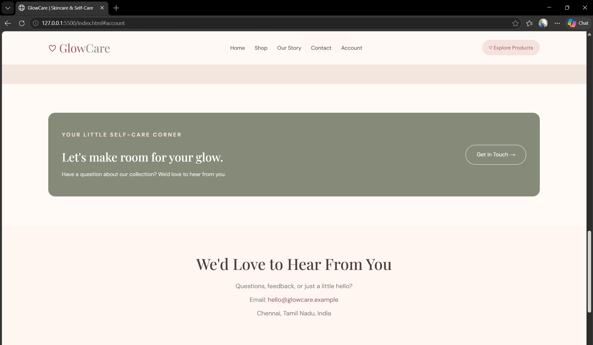

# Ex02 Commercial Website
## Date: 30/10/2026

## AIM
To create a commercial website using CSS Flexbox.

## ALGORITHM
### STEP 1
Create an HTML file (index.html)

### STEP 2
Create a CSS file (style.css)

### STEP 3
Include a navigation bar with links to different sections.

### STEP 4
Add structured sections for Homepage, Products / Services, About Us, Contact Details and User Account.

### STEP 5
Include social media links at the footer with copyright information.

### STEP 6
Define global styles for fonts, colors, and layout.

### STEP 7
Style the header, navigation bar, and sections.

### STEP 8
Use Flexbox for layout design.

### STEP 9
Add hover effects and transitions for interactivity.

### STEP 10
Add Images and Media.

### STEP 11
Use optimized images for a professional look.

### STEP 12
Open the HTML file in a browser to check layout and functionality.

### STEP 13
Fix styling issues and refine content placement.

### STEP 14
Deploy the website.

### STEP 15
Upload to GitHub Pages for free hosting.

## PROGRAM

```


<!DOCTYPE html>
<html lang="en">
<head>
    <meta charset="UTF-8">
    <meta name="viewport" content="width=device-width, initial-scale=1.0">
    <title>GlowCare | Skincare & Self-Care</title>

    <link rel="preconnect" href="https://fonts.googleapis.com">
    <link rel="preconnect" href="https://fonts.gstatic.com" crossorigin>

    <link href="https://fonts.googleapis.com/css2?family=DM+Sans:wght@400;500;600;700&family=Playfair+Display:wght@400;500;600;700&display=swap"
          rel="stylesheet">

    <style>
        /* GENERAL STYLES */

        * {
            margin: 0;
            padding: 0;
            box-sizing: border-box;
        }

        :root {
            --cream: #fffaf6;
            --pink: #f5e2dd;
            --rose: #bd7375;
            --dark-rose: #96575b;
            --brown: #494139;
            --sage: #858b78;
            --white: #ffffff;
        }

        html {
            scroll-behavior: smooth;
            scroll-padding-top: 100px;
        }

        body {
            font-family: 'DM Sans', sans-serif;
            background: var(--cream);
            color: var(--brown);
            line-height: 1.7;
        }

        a {
            text-decoration: none;
            color: inherit;
        }

        .section {
            padding: 80px 8%;
        }

        .section-heading {
            font-family: 'Playfair Display', serif;
            font-size: 40px;
            font-weight: 500;
            text-align: center;
            margin-bottom: 10px;
        }

        .section-subtitle {
            text-align: center;
            color: #81766e;
            margin-bottom: 40px;
        }

        /* NAVIGATION */

        header {
            background: rgba(255, 250, 246, 0.97);
            position: sticky;
            top: 0;
            z-index: 100;
            border-bottom: 1px solid #f1e5df;
        }

        .navbar {
            padding: 18px 8%;
            display: flex;
            justify-content: space-between;
            align-items: center;
            gap: 20px;
        }

        .logo {
            font-family: 'Playfair Display', serif;
            font-size: 30px;
            color: var(--dark-rose);
            white-space: nowrap;
        }

        .logo span {
            color: var(--sage);
        }

        .nav-links {
            display: flex;
            align-items: center;
            flex-wrap: wrap;
            gap: 25px;
            list-style: none;
        }

        .nav-links a {
            font-size: 14px;
            transition: color 0.3s;
        }

        .nav-links a:hover {
            color: var(--rose);
        }

        .cart-button {
            background: var(--pink);
            color: var(--dark-rose);
            padding: 9px 17px;
            border-radius: 30px;
            font-size: 13px;
            white-space: nowrap;
        }

        /* HERO SECTION */

        .hero {
            min-height: 530px;
            padding: 75px 8%;
            background:
                linear-gradient(
                    90deg,
                    rgba(248, 231, 224, 0.98) 0%,
                    rgba(248, 231, 224, 0.88) 45%,
                    rgba(248, 231, 224, 0.15) 100%
                ),
                url("https://images.unsplash.com/photo-1608248543803-ba4f8c70ae0b?auto=format&fit=crop&w=1800&q=85")
                center/cover no-repeat;

            display: flex;
            align-items: center;
        }

        .hero-content {
            max-width: 570px;
        }

        .eyebrow {
            color: var(--dark-rose);
            font-size: 12px;
            font-weight: 700;
            letter-spacing: 3px;
            text-transform: uppercase;
            margin-bottom: 20px;
        }

        .hero h1 {
            font-family: 'Playfair Display', serif;
            font-size: clamp(45px, 6vw, 76px);
            font-weight: 500;
            line-height: 1.12;
            margin-bottom: 22px;
        }

        .hero h1 span {
            color: var(--rose);
            font-style: italic;
        }

        .hero p {
            max-width: 430px;
            color: #665a53;
            font-size: 16px;
            margin-bottom: 30px;
        }

        .btn {
            display: inline-block;
            background: var(--rose);
            color: white;
            border: 1px solid var(--rose);
            border-radius: 50px;
            padding: 13px 28px;
            font-size: 14px;
            transition: all 0.3s ease;
        }

        .btn:hover {
            background: var(--dark-rose);
            border-color: var(--dark-rose);
            transform: translateY(-3px);
        }

        .text-link {
            display: inline-block;
            color: var(--dark-rose);
            border-bottom: 1px solid var(--rose);
            margin-top: 15px;
            font-size: 14px;
        }

        /* BENEFITS */

        .benefits {
            display: flex;
            justify-content: center;
            flex-wrap: wrap;
            gap: 25px 55px;
            padding: 23px 8%;
            background: #f0eee6;
            color: #656a57;
            text-align: center;
            font-size: 13px;
        }

        /* PRODUCTS */

        .products {
            padding: 80px 8%;
        }

        .product-container {
            display: flex;
            justify-content: center;
            flex-wrap: wrap;
            gap: 25px;
        }

        .product-card {
            flex: 1 1 220px;
            max-width: 280px;
            background: white;
            border: 1px solid #f0e6e0;
            border-radius: 14px;
            overflow: hidden;
            display: flex;
            flex-direction: column;
            transition: transform 0.35s, box-shadow 0.35s;
        }

        .product-card:hover {
            transform: translateY(-8px);
            box-shadow: 0 15px 35px rgba(104, 74, 62, 0.12);
        }

        .product-image {
            position: relative;
            overflow: hidden;
            background: var(--pink);
        }

        .product-image img {
            display: block;
            width: 100%;
            height: 245px;
            object-fit: cover;
            transition: transform 0.5s;
        }

        .product-card:hover .product-image img {
            transform: scale(1.05);
        }

        .badge {
            position: absolute;
            top: 13px;
            left: 13px;
            background: white;
            color: var(--dark-rose);
            padding: 5px 11px;
            border-radius: 30px;
            font-size: 11px;
        }

        .product-info {
            padding: 19px;
            display: flex;
            flex-direction: column;
            flex: 1;
        }

        .product-info h3 {
            font-family: 'Playfair Display', serif;
            font-size: 20px;
            font-weight: 500;
            margin-bottom: 5px;
        }

        .product-description {
            color: #8b8079;
            font-size: 12px;
            margin-bottom: 15px;
        }

        .product-bottom {
            display: flex;
            justify-content: space-between;
            align-items: center;
            gap: 8px;
            margin-top: auto;
        }

        .price {
            color: var(--dark-rose);
            font-size: 17px;
            font-weight: 700;
        }

        .add-button {
            display: inline-block;
            background: transparent;
            border: 1px solid #d8b6ae;
            color: var(--dark-rose);
            padding: 8px 12px;
            border-radius: 30px;
            font-family: inherit;
            font-size: 12px;
            cursor: pointer;
            transition: all 0.3s;
        }

        .add-button:hover {
            background: var(--rose);
            color: white;
            border-color: var(--rose);
        }

        /* ABOUT SECTION */

        .about {
            background: #f3e6df;
            display: flex;
            align-items: center;
            justify-content: center;
            flex-wrap: wrap;
            gap: 55px;
        }

        .about-image {
            flex: 1 1 300px;
            max-width: 490px;
        }

        .about-image img {
            width: 100%;
            height: 390px;
            object-fit: cover;
            border-radius: 180px 180px 18px 18px;
        }

        .about-content {
            flex: 1 1 300px;
            max-width: 510px;
        }

        .about-content .eyebrow {
            margin-bottom: 12px;
        }

        .about-content h2 {
            font-family: 'Playfair Display', serif;
            font-size: 43px;
            font-weight: 500;
            line-height: 1.2;
            margin-bottom: 20px;
        }

        .about-content p {
            color: #75685f;
            margin-bottom: 20px;
        }

        .features {
            display: flex;
            flex-wrap: wrap;
            gap: 15px;
            margin: 25px 0;
        }

        .feature {
            flex: 1 1 130px;
            padding: 15px;
            background: rgba(255, 255, 255, 0.55);
            border-radius: 10px;
        }

        .feature strong {
            display: block;
            color: var(--dark-rose);
            font-size: 14px;
        }

        .feature small {
            color: #81766e;
            font-size: 11px;
        }

        /* ACCOUNT SECTION */

        .account {
            margin: 75px 8%;
            padding: 45px 35px;
            background: var(--sage);
            color: white;
            border-radius: 18px;
            display: flex;
            justify-content: space-between;
            align-items: center;
            flex-wrap: wrap;
            gap: 25px;
        }

        .account h2 {
            font-family: 'Playfair Display', serif;
            font-size: 30px;
            font-weight: 500;
            margin-bottom: 8px;
        }

        .account p {
            color: #f4f2ed;
            font-size: 14px;
        }

        .account .btn {
            background: transparent;
            border-color: white;
            white-space: nowrap;
        }

        .account .btn:hover {
            background: white;
            color: var(--sage);
        }

        /* CONTACT */

        .contact {
            background: #fff6f1;
            text-align: center;
            padding: 65px 8%;
        }

        .contact p {
            color: #81766e;
            margin: 8px 0;
        }

        .contact a {
            color: var(--dark-rose);
        }

        /* FOOTER */

        footer {
            background: #42483c;
            color: #f9f4ec;
            padding: 45px 8% 20px;
        }

        .footer-content {
            display: flex;
            justify-content: space-between;
            align-items: flex-start;
            flex-wrap: wrap;
            gap: 35px;
            padding-bottom: 30px;
        }

        .footer-brand {
            max-width: 300px;
        }

        .footer-brand .logo {
            color: #f7e1d8;
            margin-bottom: 10px;
        }

        .footer-brand p {
            color: #d5d4c9;
            font-size: 13px;
        }

        .footer-links h3 {
            font-size: 15px;
            margin-bottom: 13px;
        }

        .footer-links a {
            display: block;
            color: #d5d4c9;
            font-size: 13px;
            margin-bottom: 8px;
            transition: color 0.3s;
        }

        .footer-links a:hover {
            color: #f2c5bc;
        }

        .footer-bottom {
            border-top: 1px solid #73776a;
            padding-top: 18px;
            text-align: center;
            color: #d5d4c9;
            font-size: 12px;
        }

        /* RESPONSIVE DESIGN */

        @media (max-width: 900px) {
            .navbar {
                flex-direction: column;
                padding: 18px 5%;
            }

            .nav-links {
                justify-content: center;
                gap: 18px;
            }

            .hero {
                background-position: 60% center;
            }

            .product-card {
                flex-basis: 40%;
            }
        }

        @media (max-width: 600px) {
            .section-heading {
                font-size: 32px;
            }

            .nav-links {
                gap: 12px 16px;
            }

            .nav-links a {
                font-size: 12px;
            }

            .logo {
                font-size: 27px;
            }

            .hero {
                min-height: 450px;
                padding: 55px 7%;
                background:
                    linear-gradient(
                        rgba(248, 231, 224, 0.88),
                        rgba(248, 231, 224, 0.92)
                    ),
                    url("https://images.unsplash.com/photo-1608248543803-ba4f8c70ae0b?auto=format&fit=crop&w=900&q=80")
                    center/cover no-repeat;
            }

            .hero h1 {
                font-size: 46px;
            }

            .hero p {
                font-size: 14px;
            }

            .benefits {
                gap: 12px 20px;
                font-size: 11px;
            }

            .products {
                padding: 60px 6%;
            }

            .product-container {
                gap: 18px;
            }

            .product-card {
                flex: 1 1 100%;
                max-width: 360px;
            }

            .product-image img {
                height: 250px;
            }

            .about {
                padding: 55px 7%;
                gap: 30px;
            }

            .about-image img {
                height: 300px;
            }

            .about-content h2 {
                font-size: 34px;
            }

            .account {
                margin: 45px 5%;
                padding: 30px 22px;
            }

            .account h2 {
                font-size: 26px;
            }

            .footer-content {
                flex-direction: column;
                gap: 25px;
            }
        }

        @media (prefers-reduced-motion: reduce) {
            html {
                scroll-behavior: auto;
            }

            *, *::before, *::after {
                transition-duration: 0.01ms !important;
            }
        }
    </style>
</head>

<body>

    <!-- NAVIGATION -->
    <header>
        <nav class="navbar">
            <a href="#home" class="logo">♡ Glow<span>Care</span></a>

            <ul class="nav-links">
                <li><a href="#home">Home</a></li>
                <li><a href="#products">Shop</a></li>
                <li><a href="#about">Our Story</a></li>
                <li><a href="#contact">Contact</a></li>
                <li><a href="#account">Account</a></li>
            </ul>

            <a href="#products" class="cart-button">♡ Explore Products</a>
        </nav>
    </header>

    <!-- HERO -->
    <section class="hero" id="home">
        <div class="hero-content">
            <p class="eyebrow">Natural · Gentle · Everyday</p>

            <h1>
                Your Skin,<br>
                Your <span>Glow.</span>
            </h1>

            <p>
                Thoughtfully chosen skincare essentials
                to make your everyday routine feel like
                a little moment of self-love.
            </p>

            <a href="#products" class="btn">Explore Collection &rarr;</a>

            <br>

            <a href="#about" class="text-link">Discover our story</a>
        </div>
    </section>

    <!-- BENEFITS -->
    <section class="benefits">
        <span>✿ Everyday Essentials</span>
        <span>♡ Self-Care First</span>
        <span>❋ Simple Routines</span>
        <span>☼ Glow With Confidence</span>
    </section>

    <!-- PRODUCTS -->
    <section class="products" id="products">
        <h2 class="section-heading">The Skincare Edit</h2>

        <p class="section-subtitle">
            Little essentials. Lovely rituals. Your daily glow.
        </p>

        <div class="product-container">

            <article class="product-card">
                <div class="product-image">
                    <span class="badge">Bestseller</span>
                    
                </div>

                <div class="product-info">
                    <h3>Gentle Cleanser</h3>
                    <p class="product-description">
                        A fresh start for your skin.
                    </p>

                    <div class="product-bottom">
                        <span class="price">₹399</span>
                        <a href="#contact" class="add-button">Discover More</a>
                    </div>
                </div>
            </article>

            <article class="product-card">
                <div class="product-image">
                    
                </div>

                <div class="product-info">
                    <h3>Hydrating Serum</h3>
                    <p class="product-description">
                        A little extra hydration.
                    </p>

                    <div class="product-bottom">
                        <span class="price">₹599</span>
                        <a href="#contact" class="add-button">Discover More</a>
                    </div>
                </div>
            </article>

            <article class="product-card">
                <div class="product-image">
                    
                </div>

                <div class="product-info">
                    <h3>Daily Moisturizer</h3>
                    <p class="product-description">
                        Comfort and care in every drop.
                    </p>

                    <div class="product-bottom">
                        <span class="price">₹449</span>
                        <a href="#contact" class="add-button">Discover More</a>
                    </div>
                </div>
            </article>

            <article class="product-card">
                <div class="product-image">
                    <span class="badge">Daily Essential</span>
                    
                </div>

                <div class="product-info">
                    <h3>Daily Sunscreen</h3>
                    <p class="product-description">
                        Your everyday sun-care step.
                    </p>

                    <div class="product-bottom">
                        <span class="price">₹499</span>
                        <a href="#contact" class="add-button">Discover More</a>
                    </div>
                </div>
            </article>

        </div>
    </section>

    <!-- ABOUT -->
    <section class="about section" id="about">
        <div class="about-image">
            
        </div>

        <div class="about-content">
            <p class="eyebrow">A little about us</p>

            <h2>Skincare is more than a routine.</h2>

            <p>
                At GlowCare, we believe that caring for your skin
                should feel simple, personal, and enjoyable.
                Your routine doesn't need to be complicated
                to become a beautiful part of your day.
            </p>

            <p>
                Take a breath, slow down, and make a little
                time for yourself. Because you deserve it.
            </p>

            <div class="features">
                <div class="feature">
                    <strong>✿ Simple Care</strong>
                    <small>Everyday essentials</small>
                </div>

                <div class="feature">
                    <strong>♡ Feel-Good Rituals</strong>
                    <small>Time just for you</small>
                </div>
            </div>

            <a href="#contact" class="btn">Say Hello &rarr;</a>
        </div>
    </section>

    <!-- ACCOUNT -->
    <section class="account" id="account">
        <div>
            <p class="eyebrow" style="color: #f7e1d8;">
                Your little self-care corner
            </p>

            <h2>Let's make room for your glow.</h2>

            <p>
                Have a question about our collection?
                We'd love to hear from you.
            </p>
        </div>

        <a href="#contact" class="btn">Get in Touch &rarr;</a>
    </section>

    <!-- CONTACT -->
    <section class="contact" id="contact">
        <h2 class="section-heading">We'd Love to Hear From You</h2>

        <p>Questions, feedback, or just a little hello?</p>

        <p>
            Email:
            <a href="mailto:hello@glowcare.example">
                hello@glowcare.example
            </a>
        </p>

        <p>Chennai, Tamil Nadu, India</p>
    </section>

    <!-- FOOTER -->
    <footer>
        <div class="footer-content">

            <div class="footer-brand">
                <a href="#home" class="logo">♡ GlowCare</a>

                <p>
                    A little self-care, a little softness,
                    and a glow that feels like you.
                </p>
            </div>

            <div class="footer-links">
                <h3>Explore</h3>
                <a href="#home">Home</a>
                <a href="#products">Shop Products</a>
                <a href="#about">Our Story</a>
                <a href="#account">Account</a>
            </div>

            <div class="footer-links">
                <h3>Find Us</h3>
                <a href="https://www.instagram.com/"
                   target="_blank" rel="noopener noreferrer">Instagram ↗</a>
                <a href="https://www.pinterest.com/"
                   target="_blank" rel="noopener noreferrer">Pinterest ↗</a>
                <a href="https://www.facebook.com/"
                   target="_blank" rel="noopener noreferrer">Facebook ↗</a>
            </div>

        </div>

        <div class="footer-bottom">
            <p>&copy; 2026 GlowCare. Made with care ♡</p>
        </div>
    </footer>

</body>
</html>
```


## OUTPUT










## RESULT
The program for creating commercial website using CSS Flexbox is executed successfully.
